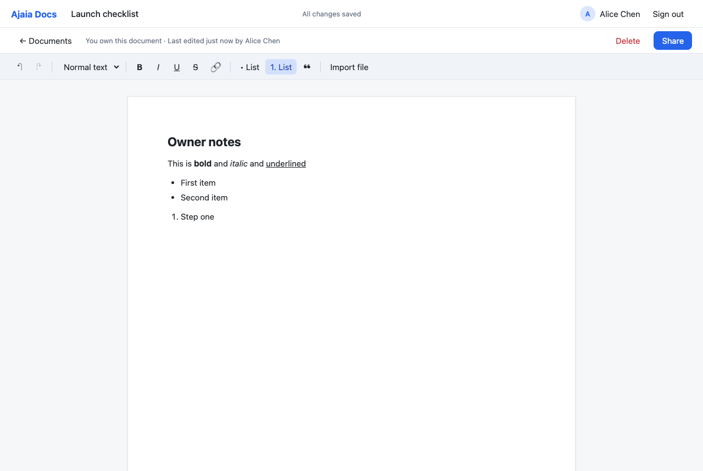

# Ajaia Docs

A lightweight collaborative document editor. Users can create and format documents, import files, share with teammates as editors or viewers, and see each other's changes without reloading.

**Live demo:** _add your deployed URL here_ (see [Deploying](#deploying))



## Demo accounts

All seeded accounts use the password **`demo1234`**. The login screen also has one-click buttons for each one.

| User | Email | Seeded access |
|---|---|---|
| Alice Chen | `alice@ajaia.test` | Owns "Q3 Planning Notes" |
| Bob Patel | `bob@ajaia.test` | Editor on Q3 Planning Notes; owns "Bob's private draft" |
| Carol Diaz | `carol@ajaia.test` | Viewer on Q3 Planning Notes |

To test sharing, sign in as a second user in a private window or another browser. Session cookies are per browser profile.

## What works

- **Documents:** create, rename (click the title), edit, delete (owner only). Edits autosave about 0.8 s after you stop typing. ⌘/Ctrl+S saves immediately. The header shows the save status, and the browser warns before you close a tab with unsaved changes.
- **Rich text:** bold, italic, underline, strikethrough, Heading 1–3, bulleted and numbered lists, quotes, links, undo/redo.
- **File upload:** supports `.txt`, `.md` and `.docx`, up to 2 MB.
  - On the document list, **Upload file** creates a new document from the file. The file name becomes the title.
  - In the editor, **Import file** inserts the file's content at the cursor.
  - Other file types are rejected with a message that lists the supported types. The same limits are shown in the UI.
- **Sharing:** the owner shares by email and picks *Can edit* or *Can view*. The owner can also change a person's role or remove them. The document list separates **My documents** from **Shared with me** and shows badges for owner, editor and viewer. Viewers get a read-only editor with no toolbar.
- **Seeing other people's edits:** an open document checks for changes every 5 s. Other people's saves appear without a reload. If two people edit at the same time, the second save is rejected (HTTP 409) instead of silently overwriting the first. That user then chooses **Load their version** or **Keep mine**. If your access is removed while the document is open, you are told.
- **Persistence:** documents, sharing and sessions are stored in SQLite. Formatting is stored as sanitized HTML.

## Run locally

Requires **Node.js 22.13 or newer** (the app uses the built-in `node:sqlite`). Node 24 is recommended (see `.nvmrc`).

```bash
npm install
npm run dev          # API on :3001, web on http://localhost:5173 (hot reload)
```

To run a production build:

```bash
npm run build
npm start            # http://localhost:3001
```

The database file is created at `data/app.db` and seeded on first start. To reset it, delete the `data/` folder. Environment variables: `PORT` (default 3001), `DATABASE_PATH`.

## Tests

```bash
npm test             # API tests (Vitest + Supertest, in-memory SQLite)
npm run typecheck
```

`server/app.test.ts` covers:

- auth
- create, rename, edit and reopen with formatting preserved
- HTML sanitization
- input validation
- the stale-save 409
- the full sharing and role matrix (owner, editor, viewer, revoked, never shared)
- `.md`, `.txt` and `.docx` import, plus rejection of bad files

There is also a browser test that drives three users through the real UI and regenerates the screenshots in `docs/screenshots/`:

```bash
rm -rf data && npm run build && npm start      # terminal 1 (needs a fresh DB)
npx playwright install chromium && npm run e2e # terminal 2
```

## Deploying

The app is a single Node service. Express serves both the API and the built frontend, so a single URL serves everything.

**Render (free, no credit card):** push this repo to GitHub. In Render, choose **New → Blueprint** and select the repo. `render.yaml` sets the build command (`npm ci && npm run build`), the start command (`npm start`) and the health check (`/api/health`).

> On Render's free plan the filesystem is not persistent, so the SQLite database resets when the instance restarts or redeploys. Free instances also sleep after about 15 minutes idle, and the first request after that takes about 30 s. The demo users and sample documents are re-seeded on every boot, so the review flow always works. For durable data, add a disk and set `DATABASE_PATH` (commented out in `render.yaml`).

**Anywhere else:** the `Dockerfile` builds the same app. Mount a volume at `/data` to keep the database.

## Project layout

```
server/            Express API (TypeScript)
  app.ts           routes, validation, upload handling
  documents.ts     document and sharing data access + permission checks
  auth.ts          password hashing, sessions
  importFile.ts    .txt/.md/.docx → HTML
  sanitize.ts      HTML allow-list applied to everything stored
  db.ts, seed.ts   schema and demo data
  app.test.ts      API tests
client/src/        React + TipTap frontend
  pages/           login, document list, editor
  components/      toolbar, share dialog, header
  useDocumentSync.ts  autosave queue, conflict handling, polling
e2e/smoke.mjs      Playwright walkthrough
docs/              architecture note, AI workflow note, screenshots
```

See [docs/ARCHITECTURE.md](docs/ARCHITECTURE.md) for design decisions and trade-offs, and [docs/AI_WORKFLOW.md](docs/AI_WORKFLOW.md) for how AI was used.
